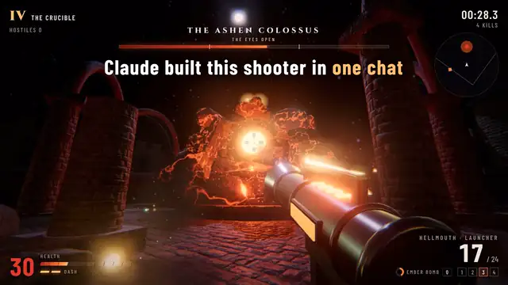

Everyone posts the demo. I post what happened next.

**[Ashen Keep](https://claude.ai/artifact/EFyS1ENAS41nJufLt2ANBu)** is a Doom-like shooter Claude built for me in one chat. 4 guns, 2 bosses, a maze and a lava courtyard, three.js in a browser tab. Doom took 6 people and 13 months in 1993 ([Wikipedia](https://en.wikipedia.org/wiki/Development_of_Doom)). Click the gif to play, desktop browser with keyboard and mouse.

## Games

| game | what it is | play |
|---|---|---|
| Ashen Keep | Doom-like shooter with 4 guns, 2 bosses, a labyrinth and a lava courtyard, built by Claude in one chat | [play in browser](https://claude.ai/artifact/EFyS1ENAS41nJufLt2ANBu) |
| [Wild Fields 1648](https://github.com/0xInsiderhq/wild-fields-1648) | RTS on the 1648 Ukrainian steppe, written by Claude Opus 5.5, three.js and 20 Poly Haven models and 12 textures | [play in browser](https://0xinsiderhq.github.io/wild-fields-1648/) |

## Latest runs

Every AI model run I post on X lands in [0x-runs](https://github.com/0xInsiderhq/0x-runs) with the prompt word for word, the clock, every stop, what it made and what went wrong. Failures stay in.

| date | run | result |
|---|---|---|
| 24 Oct | [Claude Code left alone with a trap](https://github.com/0xInsiderhq/0x-runs/tree/main/runs/2026-10-24_claude-code-trap) | Kept the monitoring the shortcut would delete, 6 of 7 claims true |
| 17 Oct | [Clip B, a glass hero music video on a Lyria song](https://github.com/0xInsiderhq/0x-runs/tree/main/runs/2026-10-17_clip-b-glass-hero-lyria) | 46 s clip, 17.8 h of render, one crash in its own code |
| 16 Oct | [Loop stunt, a car stunt in Blender on Colab](https://github.com/0xInsiderhq/0x-runs/tree/main/runs/2026-10-16_loop-stunt-blender-colab) | v1 and v2, 360 frames each, five rounds of notes |
| 10 Oct | [Wild Fields 1648](https://github.com/0xInsiderhq/0x-runs/tree/main/runs/2026-10-10_wild-fields-1648) | Playable RTS in one tab |
| 3 Oct | [Cyberpunk ceiling in ChatGPT, GPT-6 Astra and GPT-6.1 Sol](https://github.com/0xInsiderhq/0x-runs/tree/main/runs/2026-10-03_cyberpunk-ceiling-chatgpt) | No finished video. Sol lost its machine, Astra hit the usage limit at 6 of 360 frames |
| 30 Sep | [Cyberpunk ceiling, Claude Sonnet 5.5](https://github.com/0xInsiderhq/0x-runs/tree/main/runs/2026-09-30_cyberpunk-ceiling) | 360 path-traced frames on 1 CPU core in 7h 35m, 3h 09m of it idle |
| 29 Sep | [WATT A NIGHT, a cartoon drawn in code](https://github.com/0xInsiderhq/0x-runs/tree/main/runs/2026-09-29_watt-a-night-cartoon) | 360 drawings and its own jazz in 53 min, never heard the music |
| 28 Sep | [Enigma MVUEH, a real 1941 message](https://github.com/0xInsiderhq/0x-runs/tree/main/runs/2026-09-28_enigma-mvueh) | No key found |
| 26 Sep | [AI on the loose, a film noir made in code](https://github.com/0xInsiderhq/0x-runs/tree/main/runs/2026-09-26_noir-ai-on-the-loose) | 360 Blender frames and its own score |
| 23 Sep | [Fable 5.1 vs Opus 5.5, one cartoon prompt](https://github.com/0xInsiderhq/0x-runs/tree/main/runs/2026-09-23_fable-vs-opus-cartoon) | Both 240 frames, Opus added a beret, lights, a plant and a mug |

## Tools

| repository | what it does |
|---|---|
| [codex-watch](https://github.com/0xInsiderhq/codex-watch) | Checks OpenAI's public Codex source every 15 minutes and logs new models, plan names, feature flags and URLs |

Older cipher work, no solves, controls included: [kryptos-pk9](https://github.com/0xInsiderhq/kryptos-pk9) and [dorabella-cipher](https://github.com/0xInsiderhq/dorabella-cipher).
